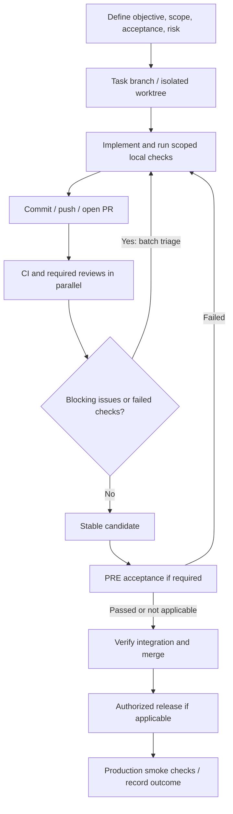

# AI-Native Development Workflow

English | [简体中文](AI_NATIVE_DEVELOPMENT_WORKFLOW.zh-CN.md)

Status: recommended shared baseline · Version: 1.0

## 1. Purpose and adoption

This is a technology-neutral engineering standard for small teams and individual maintainers using AI coding agents, including Codex. Reduce feedback latency, repeated testing, review loops, unnecessary deployments and context loss without weakening correctness, security, privacy or release controls.

Use short-lived branches (trunk-based development), continuous integration, risk-based testing, small batches, incremental verification and explicit completion criteria. Deterministic checks belong in automated tests/CI; AI review focuses on semantic risks; the Owner arbitrates scope, risk and authorization. Adopt only the mechanisms that solve actual project needs.

When adopting this standard:
- Resolve this document at an immutable Manifest commit and record the source URL/SHA in the target repository. Read the full document, not just an excerpt. Review updates explicitly rather than silently fetching changing instructions on every run.
- Audit existing AGENTS.md, local instructions, tests, CI, reviews, deployment scripts, permissions and recent PRs. Preserve technology stack, business invariants, secrets boundaries, existing authorized operations and stronger required controls unless the Owner expressly approves changes.
- Implement a focused migration PR, remove conflicting obsolete rules, and provide evidence of validation plus exact manual settings for controls not accessible to the agent. Do not use newly edited instructions to bypass gates applicable to the migration itself.
- Make local policy self-contained (including essential gates in AGENTS.md), reference this baseline for provenance, and document intentional deviations and rationale. Do not rely on network access or remote instructions being loaded automatically by agents.
- No mandated language, package manager, CI provider, hosting platform, staging topology or merge method. Do not introduce a staging service, test framework, new agent or deployment platform solely to comply. Where a capability is absent, document an appropriate equivalent, or a blocker if a required safeguard cannot be satisfied.

## 2. Default lifecycle

A Draft PR may be opened early to preserve work and start CI; mark ready when reviewable. Prefer a separate worktree for agent tasks, especially concurrent ones. Start from a verified target-branch baseline; preserve unrelated edits; make logical commits, not one commit per edit. Protect the main branch and use a PR for changes by default.

Local checks: self-inspect the diff, run affected tests and relevant static checks. A full independent local AI review is not a precondition for every push or PR creation. Do not duplicate reviews on identical inputs merely because a Git action follows.

Run independent CI, code review and necessary security review concurrently where supported. Wait for required results, collect feedback, then fix a batch rather than push for each comment. Cancel superseded CI safely; never automatically cancel an in-flight production deployment or migration using the same rule.

Formal PRE acceptance, if required, occurs after necessary checks and reviews pass and blockers are resolved. Earlier remote debugging is an explicit exception, not final acceptance. Merge only with current evidence. A merge is not authorization to deploy.

## 3. Risk classification and gates

Classify by behavioral impact, blast radius, trust boundaries, data and dependencies, not line count or extension. Mixed changes take the highest relevant risk; uncertainty raises rather than lowers the level. Reassess if the diff expands. A policy/permissions/CI gate change is not ordinary documentation.

| Gate | R0 non-runtime | R1 low | R2 medium | R3 high |
| --- | --- | --- | --- | --- |
| Examples | ordinary docs, comments | CSS, copy, isolated presentation | feature, API, state, performance | auth, data migration, privacy, payments, credentials, trust boundaries, critical CI/release controls |
| Local diff inspection | Required | Required | Required | Required |
| Scoped tests/static checks | As applicable | Required | Required | Required |
| Fast CI / applicable checks | Required | Required | Required | Required |
| Full unit/integration suite | Not needed | Impact-based | Required for affected application/suites | Required for affected systems, expand for uncertain impact |
| Independent local AI review | Not needed | Optional | Optional | Required or approved equivalent independent review |
| Remote code review | Optional | Required | Required | Required |
| Security review | Not needed | If security-relevant | If security-relevant | Required |
| E2E / integration acceptance | Not needed | Impact-based | Relevant critical paths | Critical, negative and failure paths |
| PRE or equivalent | Not needed | Impact-based | Required when applicable | Required or approved equivalent |
| Rollback plan | Not needed | As applicable | Brief | Explicit compatibility, recovery and rollback |
| Production authorization | If applicable | If applicable | If applicable | Explicit risk and release authorization |

“Required” applies to the relevant project and change, not every tool listed. For a library/CLI, package smoke tests or isolated integration environments may replace PRE. For mobile/desktop, signed candidate builds and platform-specific acceptance may be appropriate. If a required reviewer, test or environment is unavailable, report the blocker; never silently treat it as passed. An approved alternative must provide comparable assurance. The Owner can require stricter gates. Existing access controls remain authoritative.

## 4. Review and convergence

### Responsibilities and findings

Code review addresses correctness, regressions, contracts and maintainability when materially relevant. Security review addresses trust boundaries, abuse, secrets, privacy, data integrity and dependencies. Mechanical style, types, lint and known regressions belong in CI. Review only the task's diff and materially affected context; findings need a plausible trigger, impact and actionable evidence. Do not expand the task to fix unrelated historical debt.

| Severity | Meaning | Disposition |
| --- | --- | --- |
| P0 | Critical compromise, data loss or severe outage | Block |
| P1 | Major correctness, security or core regression | Block |
| P2 | Material but limited defect | Block if acceptance, safety or risk demands it; otherwise defer with rationale |
| P3 | Minor issue or local improvement | Normally non-blocking |
| Suggestion | Future improvement | Optional follow-up |

These are internal levels; map provider labels by actual impact, not blindly by name. Valid is not synonymous with blocking. Never downgrade to meet a budget. Record disposition: fixed (with evidence), false positive/not applicable (reason), or deferred (reason and follow-up reference where useful). New or worsened safety, privacy, integrity and acceptance failures must not be deferred merely to ship.

### Review budget

Default full feedback/fix cycles: R0 zero; R1 up to two; R2 up to three; R3 three before Owner arbitration. Count a parallel set of reviews as one cycle; keep the count across sessions and pushes. Local and remote required reviews can be in the same cycle. Budgets are limits on autonomous iteration, not safety exceptions. At the limit, stop if unresolved blockers remain, report root cause, evidence, options and task state; split, pause or continue only on Owner decision. Never merge with unresolved blocking findings or missing required evidence.

After a fix, locally verify the incremental diff, original finding and impacted regression paths. Expand on new contracts, security boundaries, shared dependencies or uncertain impact. Remote services may review the whole PR; don't claim incremental support unless verified. Check required completion for the final head and relevant base; a bot reaction, stale approval, absence of comments or missing status alone is not proof. Do not duplicate an in-progress review. Configure provider settings to match policy where possible; document manual steps otherwise. When a provider runs extra non-required reviews, triage credible findings before merge; do not ignore them or mistake comments for enforced checks.

## 5. CI and verification evidence

- Reuse existing project commands. Pin or derive toolchain versions from a single project source; use lockfiles where available. Provide fast PR checks (aim for minute-scale feedback) and extended suites based on risk, main updates, schedule or release. Do not trade away necessary coverage to meet timing targets.
- Run lint/type checks, unit/integration tests, builds and relevant E2E, dependency/security checks and migration/package validation as appropriate. Ensure test discovery/partitioning does not omit tests. Use isolated runners, synthetic data and fake providers. Never use shared PRE/PRO or real customer data as test fixtures.
- Parallelize only independent tasks; isolate writable build/test state, ports and caches. Cache safe dependencies using appropriate lockfile/toolchain keys. Set timeouts and retain sanitized failure artifacts. Avoid unnecessary reruns and cancel obsolete same-PR CI.
- Use least-privilege credentials; untrusted PR code must not run with deployment secrets, write tokens or privileged trusted runners. Separate privileged release workflows from untrusted CI. Pin or verify external workflow dependencies according to project supply-chain policy.
- Required checks must always emit a reliable final gate. Conditional jobs need explicit applicability and an aggregate gate that fails on missing, cancelled or failed required results; avoid a path-filtered workflow that leaves a required check pending. Do not let skipped jobs or a user-controlled risk label bypass safety checks. Use protected policy or trusted evaluation and conservative fallback for uncertain changes.
- Configure branch protection/rulesets and actual required checks after verifying their names and behavior. Avoid mandatory approvals impossible for a solo maintainer; no admin bypass or auto-merge that ignores required review. If AI review is only a comment, document how the authorized merge actor verifies it; don't claim GitHub enforces it without a real gate.
- Record check name, command, result, head/base or integration SHA, environment/toolchain and relevant inputs. Reuse evidence only when inputs and dependencies are equivalent; run affected checks if changed. Verify the actual integration result, not just an isolated branch. Unavailable or flaky checks are not passes.

## 6. Candidate and release management

DEV: frequent iteration, isolated local data and mocks. PRE: stable candidate acceptance using realistic but isolated resources. PRO: real users/data, controlled change, monitored outcomes. Map these concepts to the project's real environment; no forced new environment.

For a shared PRE, serialize deployments/acceptance or reserve a candidate slot, verify the running candidate before and after acceptance and do not deploy each push by default. Record candidate SHA/tree, build inputs, artifact digest if available, environment/config identity (no secrets), deployment ID and acceptance results. Health checks alone do not prove business behavior. Cover event handlers, external integrations or platform limitations separately, with authorization.

Prefer build once/deploy many when environment isolation, signing, configuration and platform capabilities allow. Otherwise verify reproducible source/build-input equivalence and explicitly check environment differences. Do not reuse production bindings or credentials for PRE. Rebase/squash/merge can change SHA; compare integrated code tree, dependencies, build configuration, tags/version and generated inputs. If material changes or new base changes invalidate acceptance, rerun affected checks and PRE as needed. A documentation-only edit can reuse acceptance only with proven runtime/build equivalence.

Release from the verified integrated revision, with existing authorization, preflight, security checks, migrations and rollback readiness. No automatic production deployment unless explicitly authorized and existing controls are satisfied. Separate deployment from destructive operations, real external effects and data migrations; verify the target and scope. Prefer backward-compatible staged migrations; code rollback is not data rollback. Require recovery points and compatible rollback or a forward-fix plan for high-risk changes. After release, run relevant smoke/readiness/behavior checks, record actual deployed version and outcome; stop/escalate on failure. Do not expose private operational data in public records.

## 7. Context and scope

Before implementing, record objective, original requirement, in-scope/non-goals, concrete acceptance criteria, risk, authorization, base SHA and task branch. Keep compact task state in the PR/issue or a per-worktree ignored directory such as .task/task.md and .task/progress.md. The latter is not automatically shared across hosts; put sanitized cross-host handoff state in PR/issue. Do not commit transient progress to main or add needless commits to update it.

At milestones (implementation, test, review batch, candidate, handoff), record current head, stage, completed/remaining work, checks and results, review cycle/dispositions, blockers, candidate evidence and next action. After context compression, session restart or agent handoff, reread task state and local project instructions, reconcile against Git and current checks before acting. Keep original goals stable; request Owner decision before material scope change. Never persist secrets, personal/customer data or private config in public artifacts.

## 8. Completion and operational boundaries

A task is ready to merge when acceptance criteria are met, necessary checks and reviews completed on valid inputs, blockers resolved, deferrals recorded, required PRE/equivalent acceptance and rollback evidence available, and authorized merge conditions met. Stop unnecessary review and unrelated optimization once done.

Report distinct states: implementation complete, ready for merge, merged, ready for release, deployed, production verified; report missing/blocked stages explicitly. Git push/PR/merge, PRE/PRO deploy, migrations and destructive operations are separate authorizations. Do not infer permission from this standard. Preserve unfinished work and evidence; clean up only confirmed merged, authorized and unused task branches/worktrees. Never discard unrelated or unsaved work.

## 9. Adoption checklist and metrics

In the migration PR:
- Audit and consolidate existing rules; implement project-local risk matrix, scoped verification, review guidelines, stop conditions and release workflow.
- Add or repair PR CI, required gate behavior, appropriate E2E/security checks, and a compact PR template (objective, scope, risk, acceptance, tests, reviews, blockers/deferrals, PRE, migration/rollback, limitations).
- Verify sample docs, low-risk UI/local change, normal feature, security/migration change, review-budget exhaustion, unavailable checks, candidate invalidation by runtime/base changes, safe evidence reuse and session recovery. Use simulations where real deployment is unnecessary.
- Verify actual CI runs when accessible and provide precise manual configuration steps for settings that cannot be changed. List unverified capabilities and blockers; do not claim simulated or planned work was executed in real environments.
- Track lead time, PR cycle time, CI duration, review rounds, PRE deployments, context recoveries and production change failures/recovery time where applicable. Compare actual before/after results; no separate metrics platform required.

Do not turn this baseline into more bureaucracy. Introduce controls with clear value, keep routine changes lightweight, and protect high-risk changes. A project may stage its adoption; report what remains rather than silently weakening current safeguards.
