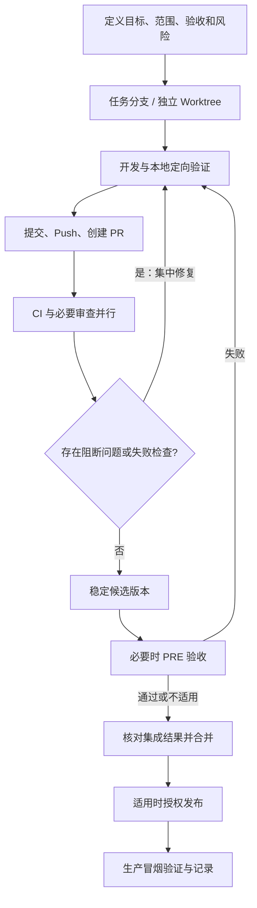

# AI 原生研发工作流规范

[English](AI_NATIVE_DEVELOPMENT_WORKFLOW.md) | 简体中文

状态：通用推荐基线 · 版本：1.0

## 1. 目标与接入方式

本规范面向使用 Codex 等 AI 编程代理的个人维护者和小型团队，不绑定具体技术栈。在不降低正确性、安全性、隐私及发布控制标准的前提下，减少重复测试、审查循环、部署成本、反馈等待和上下文丢失。

采用短生命周期分支（Trunk-Based Development）、持续集成、风险驱动测试、小批量变更、增量验证和明确的完成标准。确定性问题交给自动化测试/CI，语义风险交给 AI Review，范围、风险及授权冲突交给 Owner 仲裁。仅引入真正有价值的机制。

接入规范时：
- 将本文件解析至 Manifest 的固定 Git Commit，记录来源 URL/SHA，完整读取规范。后续更新需显式审阅，不在每次开发时自动拉取变化中的指令。
- 审计目标项目 AGENTS.md、本地约束、测试、CI、Review、部署脚本、权限及近期 PR。保留技术栈、业务不变量、密钥边界、已有操作授权及更严格的必要控制，除非 Owner 明确批准调整。
- 在独立整改 PR 中实际落地、清除冲突旧规则，并提供验证证据及无法自动配置的设置步骤。不得利用新修改的规范追溯性绕过整改任务自身适用的门禁。
- 在目标项目中保留自包含的本地规范（AGENTS.md 应包含关键门禁），引用本基线作为来源，并记录有意偏离的原因。不要依赖网络可用性或代理自动读取外部链接。
- 不强制编程语言、包管理器、CI 服务、托管平台、环境拓扑或合并方式。不要仅为符合规范而新建 PRE、测试框架、代理或发布平台。能力缺失时采用适当等价机制；无法满足必需保障时报告阻塞。

## 2. 默认研发流程

允许提前创建 Draft PR 保存进度并启动 CI，代码可审查时转为 Ready。优先使用独立 Worktree 隔离代理任务，特别是并行开发时。基于已核对的目标分支创建任务分支，保护无关修改，按逻辑原子提交，而非每编辑一次就提交。默认保护主干并通过 PR 合并。

本地执行 Diff 自检、受影响测试和相关静态检查。不再要求每次 Push 或创建 PR 前均完整独立 AI Review。同一输入的审查不因后续 Git 操作而重复。

CI、Code Review 和必要 Security Review 在支持时并行执行。等待本轮必需结果后汇总反馈、集中修复，不为每条评论单独 Push。安全取消同 PR 已过时的 CI，但不得以同一方式自动取消正在执行的生产部署或迁移。

正式 PRE 验收（适用时）后置到必要检查与审查通过、阻断问题解决之后。提前远程调试是明确例外，不算最终验收。仅凭有效的当前版本证据合并；合并不等于部署授权。

## 3. 风险分级与质量门禁

根据行为影响、故障范围、信任边界、数据及依赖分级，而不是代码行数或文件扩展名。混合变更采用最高相关风险，影响不明确时提高等级；范围扩大时重新评估。授权、CI 门禁及治理规则的修改不属于普通文档变更。

| 门禁 | R0 非运行时 | R1 低风险 | R2 中风险 | R3 高风险 |
| --- | --- | --- | --- | --- |
| 示例 | 普通文档、注释 | CSS、文案、孤立展示 | 功能、API、状态、性能 | 认证、迁移、隐私、支付、凭证、信任边界、关键 CI/发布控制 |
| 本地 Diff 自检 | 必须 | 必须 | 必须 | 必须 |
| 定向测试/静态检查 | 按需 | 必须 | 必须 | 必须 |
| 快速 CI/适用检查 | 必须 | 必须 | 必须 | 必须 |
| 全量单元/集成套件 | 无需 | 按影响 | 受影响应用/套件必须 | 受影响系统必须，影响不明时扩大 |
| 本地独立 AI Review | 无需 | 可选 | 可选 | 必须或获批等价独立审查 |
| 远程 Code Review | 可选 | 必须 | 必须 | 必须 |
| Security Review | 无需 | 安全相关时 | 安全相关时 | 必须 |
| E2E/集成验收 | 无需 | 按影响 | 相关核心路径 | 核心、异常与失败路径 |
| PRE 或等价验收 | 无需 | 按影响 | 适用时必须 | 必须或获批等价验证 |
| 回滚方案 | 无需 | 按需 | 简要 | 明确兼容性、恢复与回滚 |
| PRO 发布授权 | 适用时 | 适用时 | 适用时 | 明确风险及发布授权 |

“必须”针对项目实际具备的相关场景，而非要求采用所有列举工具。库/CLI 可用打包冒烟或隔离集成环境代替 PRE；移动/桌面应用可用签名候选包和平台验收。如果必要审查、测试或环境不可用，报告阻塞而非默认为通过。替代方案需获得批准且提供相当保障。Owner 可要求更严格的门禁，已有访问控制仍然有效。

## 4. Review 与收敛机制

### 职责与问题分级

Code Review 关注功能正确性、回归、契约和实质性可维护性风险；Security Review 关注信任边界、滥用、密钥、隐私、数据完整性和依赖。机械性的风格、类型、Lint、已知回归交给 CI。审查聚焦本次 Diff 和实际受影响的上下文，意见应提供触发条件、影响及可操作证据。不要为修复无关历史技术债务扩大任务。

| 等级 | 含义 | 处理策略 |
| --- | --- | --- |
| P0 | 严重安全破坏、数据丢失或严重故障 | 阻断 |
| P1 | 重大正确性、安全或核心回归问题 | 阻断 |
| P2 | 影响有限但实际存在的缺陷 | 根据验收、安全及风险决定是否阻断，否则记录延期依据 |
| P3 | 轻微问题或局部优化 | 通常不阻断 |
| Suggestion | 未来优化 | 可选后续任务 |

以上为内部等级，按实际影响映射审查服务的标签。有效问题不等于阻断问题，不得为了满足预算而降级。记录处理结果：已修复（证据）、误报/不适用（原因）或延期（依据及必要的后续任务链接）。新引入或显著放大的安全、隐私、完整性及验收失败，不得仅为快速上线而延期。

### Review Budget

默认完整反馈/修复周期预算：R0 为 0，R1 最多 2 轮，R2 最多 3 轮，R3 达到 3 轮仍未收敛则由 Owner 仲裁。并行的一组审查计为一轮，本地与远程必要审查可属于同一轮；跨会话及 Push 持续计数。预算是自主迭代停止条件，不是安全豁免。达到预算仍有阻断项时停止自动循环，报告根因、证据、选项和任务状态，由 Owner 决定拆分、暂停或继续。存在阻断问题或缺少必要验证证据时禁止合并。

修复后优先检查增量 Diff、原始问题及相关回归路径；涉及公共契约、安全边界、共享依赖或不确定影响时扩大验证。远程审查可能仍覆盖整个 PR，未核实前不得宣称支持增量审查。合并前核对最终 Head 及相关 Base 的必要审查完成证据；机器人表情、过期审批、无评论或缺少状态本身不能证明通过。不重复触发进行中的同类 Review。尽可能调整服务后台策略与本规范一致；无法自动配置则给出人工步骤。如果服务额外运行非必需审查，合并前仍应处理可信风险，不能忽略意见或将普通评论当作强制门禁。

## 5. CI 与验证证据

- 复用现有命令，从单一项目配置固定或派生工具链版本，适用时使用锁文件。PR 快速 CI 追求分钟级反馈，扩展测试按风险、主干更新、定时或发版触发；不为耗时目标削减必要覆盖。
- 按需执行 Lint/类型检查、单元/集成测试、构建、相关 E2E、依赖安全、迁移或打包验证。确保测试发现和分组不漏测。使用隔离 Runner、合成数据及 fake provider，不使用共享 PRE/PRO 或真实用户数据作为 fixture。
- 仅并行独立任务，隔离可写构建/测试状态、端口和缓存。按锁文件和工具链等合理键缓存安全的依赖；设置超时并保留脱敏失败证据。取消同一 PR 的过时 CI，避免无意义重跑。
- 最小权限：不可信 PR 代码不得接触部署密钥、写权限 Token 或高权限可信 Runner。隔离特权发布与不可信 CI；按供应链安全策略固定或核验外部 Action/依赖。
- 必需检查应始终产生可靠最终门禁。条件 Job 必须明确适用性，聚合门禁在必需结果缺失、取消或失败时失败；避免路径过滤导致 Required Check 永久 pending。不得因 skipped 或可由提交者操控的风险标签绕过必要检查，使用可信规则并在不确定时保守处理。
- 核实实际检查名称及行为后设置 Branch Protection/Rulesets。避免单人仓库无法满足的人工审批；禁止 Admin 绕过及忽略必要审查的自动合并。如果 AI Review 仅有评论，明确授权合并者如何核对，不宣称 GitHub 已强制执行。
- 记录检查名、命令、结果、Head/Base 或集成 SHA、环境/工具链和相关输入。仅在输入与依赖等价时复用证据，变化时重跑受影响项。验证真实集成结果，而非仅任务分支。不可用或不稳定的检查不等于通过。

## 6. 候选版本与发布管理

DEV 用于高频迭代、隔离本地数据和 Mock；PRE 用于稳定候选版本的真实但隔离的验收；PRO 面向真实用户与数据，控制变更并监测结果。根据项目实际环境映射这些概念，不强制新建环境。

共享 PRE 需串行部署/验收或保留候选版本占用，验收前后核对运行版本，默认不因每次 Push 自动部署。记录候选 SHA/代码树、构建输入、可用时的产物摘要、环境/配置标识（无密钥）、部署 ID 和验收结果。健康检查不能代替业务验收；事件处理器、外部集成及平台无法覆盖项需另行授权和验证。

在环境隔离、签名、配置和平台能力允许时优先 Build Once, Deploy Many，否则核对可复现的源码及构建输入等价性，明确环境差异。不得为 PRE 复用生产绑定或凭证。Rebase/Squash/Merge 可能改变 SHA，应比较集成代码树、依赖、构建配置、标签/版本和生成输入。实质性变化或新 Base 使证据失效时，重跑相关检查和必要 PRE。普通文档变化仅在证明不影响运行及构建时复用验收。

从经过验证的集成版本发布，遵守已有授权、预检、安全审计、迁移及回滚门禁。未经明确授权且未满足控制条件，不得自动发布生产。将部署与破坏性操作、真实外部副作用和数据迁移区分授权，并核对目标和范围。优先兼容式分阶段迁移；代码回滚不等于数据回滚。高风险变更应具备恢复点及兼容回滚或前向修复方案。发布后执行相关冒烟、就绪及业务检查，记录实际版本与结果，失败时停止/升级处理。公开记录不暴露私有运维数据。

## 7. Context Engineering 与范围控制

实施前记录目标、原始需求、In Scope/Non-Goals、明确验收标准、风险、授权、Base SHA 及任务分支。可使用 PR/Issue 或独立 Worktree 中 Git ignored 的 .task/task.md、.task/progress.md 保存精简任务状态。后者不会自动跨机器共享；需共享的脱敏信息写入 PR/Issue。不将临时进度提交至主干，也不为更新记录反复创建无价值提交。

在实现、测试、集中处理 Review、候选验收、移交等里程碑记录当前 Head、阶段、完成/剩余事项、检查结果、审查轮次及处理依据、阻断问题、候选证据、下一步。上下文压缩、新会话或代理交接后，重新读取任务状态与项目本地约束，核对 Git 和当前检查状态后继续。保持原始目标稳定，重大范围变化交由 Owner 决策。不在公开记录保存密钥、用户/客户数据或私有配置。

## 8. Definition of Done 与授权边界

满足原始验收标准、必要检查与审查在有效输入上完成、阻断项已解决、延期项已记录、必要 PRE/等价验收及回滚证据齐备、合并授权条件满足时，任务即可进入合并阶段。达到完成标准后停止无关优化和额外审查。

区分实现完成、可合并、已合并、可发布、已部署、生产已验证等状态；明确未执行及阻塞项。Git Push/PR/Merge、PRE/PRO 部署、迁移和破坏性操作是独立授权，不从本规范推断权限。保留未完成任务与证据；仅清理确认合并、获授权且无使用中的任务分支/Worktree，不丢弃无关或未保存的修改。

## 9. 接入验收清单与度量

整改 PR 应：
- 审计及合并现有规范，落实本地风险矩阵、定向验证、审查规则、停止条件及发布流程。
- 新增或修复 PR CI、必需门禁、适用 E2E/安全检查及轻量 PR 模板（目标、范围、风险、验收、测试、审查、阻断/延期项、PRE、迁移/回滚、限制）。
- 验证普通文档、低风险 UI/局部变更、普通功能、安全/迁移变更、审查预算耗尽、检查不可用、运行时代码/Base 变化导致候选失效、安全复用证据及会话恢复等场景。无需真实部署的场景可模拟演练。
- 可访问时核对实际 CI 运行结果，无法自动设置的后台配置给出精确人工步骤。明确未核实能力及阻塞，不把模拟或计划当作真实环境已验证。
- 按需记录任务 Lead Time、PR Cycle Time、CI 耗时、Review 轮次、PRE 部署次数、上下文恢复次数、生产变更失败率和恢复时间；使用实际前后数据比较，不必新建指标平台。

不要让规范成为新的流程负担。仅引入价值清晰的控制，保持常规变更轻量，保护高风险变更。允许分阶段接入，但应报告剩余工作，不得静默削弱当前保障。
